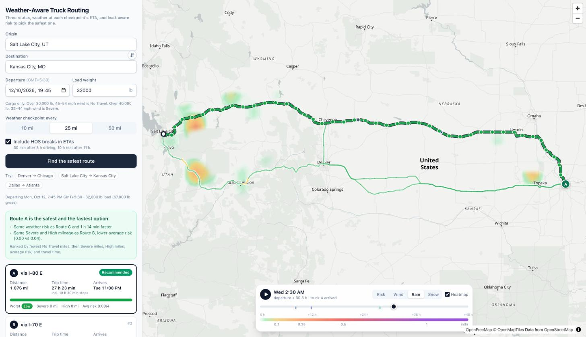

# Weather-Aware Truck Routing

[](https://github.com/ShubhamAggarwal0812/weather-aware-truck-routing/actions/workflows/ci.yml)

A React + Django app that helps a truck driver pick the safest route. It compares three truck routes, checks the forecast at every checkpoint for the hour the truck will actually be there, applies the load-weight rules, and recommends a route. A 48-hour heatmap shows how the weather moves along the corridor.

**Live app:** https://weather-truck-routing.vercel.app · **API docs:** https://truck-routing-api.vercel.app/api/v1/docs · **Walkthrough:** _Loom link_



## What it does

- **Input:** origin and destination (search or `lat, lon`), departure time, load weight, checkpoint spacing (10 / 25 / 50 mi), and optional hours-of-service breaks.
- **Three routes** from TomTom's truck router: weight-aware roads, truck speeds.
- **Checkpoints** every 10, 25 or 50 miles, each with an ETA and the forecast for that hour: wind, gusts, rain, snow and temperature.
- **Risk** for every checkpoint from the spec's tables and load rules, showing which condition and which rule set it.
- **Recommendation** in the spec's order, with a sentence explaining why it won.
- **Map** with every route coloured by risk, checkpoints, rest stops, popups, and trucks that move with the time slider.
- **Heatmap** of risk, wind, rain or snow in a 30-mile corridor, for 0–48 h after departure, with play/pause.

## Architecture

```
apps/web  (React, Vite)                              apps/api  (Django, DRF)
┌──────────────────────────────┐   /api/v1/*   ┌───────────────────────────────────────────┐
│ features/trip-planner        │ ───────────▶  │ apps/trips    plan + corridor endpoints   │
│ features/route-comparison    │  same origin  │   domain/     risk, HOS, checkpoints,     │
│ features/route-map (MapLibre)│  (Vite proxy, │               ranking, corridor grid      │
│ features/forecast (heatmap)  │  Vercel or    │   services/   planning, presenters        │
│ generated/api.ts ◀── types ──┼── openapi ────│ apps/routing  TomTom, OSRM, 3-route logic │──▶ TomTom
└──────────────────────────────┘   nginx)      │ apps/weather  Open-Meteo client           │──▶ Open-Meteo
                                               │ apps/places   place search                │──▶ TomTom / Photon
                                               │ common/       HTTP client, geo, errors    │
                                               └───────────────────────────────────────────┘
```

- **The domain is pure.** `apps/trips/domain/` has no I/O and no Django imports: risk bands, load rules, HOS breaks, checkpoint placement, ranking, corridor grid. Most tests live there.
- **Providers sit behind interfaces.** `RoutingProvider` (TomTom, OSRM) and `ForecastSource` (Open-Meteo, or a fake in tests) are protocols, so the planner never knows which one it has.
- **The API contract is generated, not hand-copied.** drf-spectacular builds `apps/api/openapi.yaml` from the serializers, and `openapi-typescript` turns it into `apps/web/src/generated/api.ts`. CI fails if either is stale, and contract tests check that real responses match the schema.
- **Frontend state is split by kind.** Server data lives in TanStack Query (plan mutation, cached corridor and place queries). View state lives in small Zustand stores per feature (selected route, forecast hour), so a 60 fps slider only re-renders what reads the hour.
- **Errors have one shape.** Each app raises a `ServiceError` subclass with a user-safe message and status, and one exception handler turns it into `{"error": ...}`.

### Request flow

```
POST /api/v1/trips/plan
  1. Routes       TomTom truck routing, gross weight = 35,000 lb tare + load, 65 mph cap.
                  The main request (asking for 2 alternatives) and two detour requests run in
                  parallel. Detours are kept only if distinct, at most 1.6 times as slow, and not
                  doubling back (a forced via point can send a route down a dead end and back).
  2. Checkpoints  mile 0, every N miles, and the destination.
  3. ETAs         TomTom's per-point travel times, plus FMCSA breaks if enabled.
  4. Weather      one batched Open-Meteo fetch for every checkpoint on every route, at its ETA.
  5. Risk         wind / rain / snow bands + load rules -> worst of the three.
  6. Ranking      No Travel mi -> Severe mi -> High mi -> average risk -> travel time.

POST /api/v1/trips/corridor-forecast   (sent once the plan arrives, so routes show first)
  Grid of forecast points within 30 mi of the routes: 49 hourly values each, plus risk per hour.
  The browser renders it as an image and redraws it as the slider moves.
```

## Spec interpretations

The brief leaves some choices open. These are the ones made; each is in code and covered by tests.

| Topic | What the app does |
|---|---|
| Band edges | Ranges share end points ("0.10–0.25", "0.25–0.50"), so each band starts at its lower bound: 0.25 in/hr of rain is High. No Travel follows the table exactly: ≥55 mph wind, but rain **>** 1.00 and snow **>** 3.0, so 1.00 in/hr of rain is still Severe. |
| Load rules | "Over 30,000 / 40,000 lb" is strict. Load rules only ever raise the wind level. A checkpoint's level is the worst of wind (after load rules), rain and snow. |
| Load weight | Cargo, as the load rules imply. Routing gets the gross weight (35,000 lb tare + load). |
| Truck speed | TomTom's truck mode runs at car speeds unless capped (73 mph average on I-80 in testing). Routes are capped at 65 mph, a common fleet governor setting. |
| Wind | Sustained 10 m wind, which is what the thresholds describe. Gusts are shown but not scored, so when the forecast leaves out gusts or temperature they show as unknown instead of failing the plan. |
| Rain / snow rate | Open-Meteo hourly totals in inches: rain + showers for rain, snowfall (depth, not water equivalent) for snow. |
| Weather timing | Wind and temperature are instantaneous, so they're interpolated to the exact ETA. Precipitation totals cover the hour *ending* at each timestamp, so a truck at 14:37 gets the 14:00–15:00 total. |
| "Severe miles" | Each checkpoint stands for the road from the midpoint with its previous checkpoint to the midpoint with its next. These stretches add up to the route length exactly. |
| No Travel | Not in the spec's ranking list, but worse than Severe, so No Travel miles are compared first, and any No Travel loses to none. If every route has some, the app says no route is safe and recommends the least exposed. |
| Average risk | Distance-weighted, Low = 0 to No Travel = 4. |
| Ties | A route stays in the running while it is within 0.1 miles on mileage, 0.01 on average risk or one minute on travel time of the best remaining route. Smaller differences are sampling noise, so the next rule decides; a full tie keeps the provider's order. A route that is ruled out is explained against the route that ruled it out, which may not be the recommended one, so the numbers shown always differ by at least that margin. |
| ETAs and HOS | With breaks on, ETAs include a 30-min break after 8 h of driving and a 10-h rest after 11 h, with the driver starting fully rested. The 60/70-hour weekly limit depends on the driver's history and is out of scope. Breaks can be turned off. |
| "Travel time" | Wall-clock trip time, including breaks. |
| Heatmap window | 0–48 h from the departure hour, so the slider shows the weather the trip will meet. |
| Departure | From now (30 min grace) to 7 days ahead, so the whole trip stays inside the 16-day forecast. |

## Performance

| | Cold | Cached |
|---|---|---|
| Plan, Salt Lake City → Kansas City at 10-mi checkpoints | ~7 s (TomTom ~5 s, weather ~1.5 s) | ~0.05 s |
| Corridor forecast (300 grid points × 49 h) | < 1 s | ~0.1 s |
| Heatmap frame (interpolated, or nearest cell for risk) | about 2 milliseconds | — |

- **Routing is the floor.** TomTom truck routing with alternatives takes about 5 s for a long trip. Detours run alongside it, not after it, which cut cold plans from 14 s to 7 s.
- **Slow weather requests are hedged.** Open-Meteo's free API usually answers in about 0.3 seconds but sometimes takes 5–30 seconds. A batch with no answer 2.5 seconds after it goes out is sent again, and the first response wins, so one slow request can't stall a plan. Time spent waiting for a free worker doesn't count, and a duplicate that hasn't gone out by the time the first answer arrives is dropped.
- **Weather calls are budgeted.** Open-Meteo counts each location as a call, with a free-tier limit of 600 a minute per IP. Checkpoints are snapped to a grid of about 5 kilometres so overlapping routes share forecasts, and the corridor grid coarsens (0.1° to 1°) until it fits in 300 points (coast-to-coast trips come to about 250–300). The corridor lines come from the browser, so the endpoint refuses lines longer than any route and grids over 600 points. A plan plus its heatmap stays under the per-minute limit. Each client may make the API fetch 3,000 uncached locations a day (`WEATHER_BUDGET`), under a third of the free daily quota, so one client can't spend it for everyone by asking for a new departure hour or new lines each time. Responses, forecasts and place searches are cached; a forecast is fetched from the departure hour through the hour after the last reading the trip needs, and reused by any later request from the same hour that it reaches far enough for.
- **The slider is smooth.** Which grid cells and weights feed each heatmap pixel is computed once per trip. A frame is then one pass over the pixels, blending the two nearest forecast hours, so the slider moves in 15-minute steps. Risk levels are categories, not amounts, so the risk layer is never blended: each pixel shows its nearest cell's level for the hour the slider is in, and the colours and legend come from the plan's own rules table. The `ImageData` goes straight into a MapLibre image source with no PNG encoding. Rows are spaced in Web Mercator so the overlay lines up at every zoom, and a soft mask drawn along the routes shapes the corridor.
- **Map updates stay cheap.** Selecting or hovering a route only swaps layer filters; route data is uploaded once. MapLibre (~280 kB gzipped) loads in its own chunk, so the form renders first.

## API

Interactive docs at `/api/v1/docs`; schema at `/api/v1/schema` (also committed as `apps/api/openapi.yaml`).

| Endpoint | Purpose |
|---|---|
| `GET /api/v1/health` | Liveness. |
| `GET /api/v1/config` | Routing provider in use and the risk tables. |
| `GET /api/v1/places?q=denver` | Place search: TomTom when keyed, else Photon (OpenStreetMap). |
| `POST /api/v1/trips/plan` | Routes with checkpoints, risk miles, HOS stops, truck positions every 15 min, and the recommendation. |
| `POST /api/v1/trips/corridor-forecast` | The heatmap grid: cells, 49 times, and wind, rain, snow and risk per hour. |

Errors are `{"error": "..."}`, plus `"fields"` for validation. No route is a 422; an upstream outage or quota limit is a 502 or 503 with a readable message. The plan, corridor and place endpoints are rate-limited per IP, and plans and heatmaps also count against the IP's weather allowance; either limit is a 429, and a trip that needs more than the whole allowance is a 422.

## Getting started

Requires [uv](https://docs.astral.sh/uv/), Node 22+, and optionally Docker.

```bash
cp .env.example .env     # add TOMTOM_API_KEY (free, no card) for truck routing
make install             # uv sync + npm ci
make dev                 # API on :8000, web on :5173 (proxies /api)
```

Without a TomTom key the app still runs on the public OSRM server and Photon search, with a notice that routing uses a car profile.

```bash
make up                  # the production images (gunicorn + nginx) on http://localhost:8080
make check               # lint + types + tests, as CI runs them
make schema              # after changing the API: regenerate openapi.yaml and the TS types
make help                # everything else
```

## Testing

- **API (186 tests, pytest):** risk bands at every boundary, load rules, HOS arithmetic, checkpoint coverage, ranking order and tolerances, weather timing and hedging, detour filtering, the corridor caps, the rate-limit client key, running on through a Redis outage, the TomTom and OSRM adapters against hand-built responses in each provider's format (respx), place search, and the endpoints end to end with fake routing and weather. One example: a 50 mph wind band crossed by two of three routes is No Travel for a 35,000 lb load, so the third route wins; with 20,000 lb the same wind is only Severe. Contract tests validate real responses against the schema and fail if `openapi.yaml` is stale.
- **Web (49 tests, Vitest + Testing Library):** trip form validation, submit payload and swap, keeping results up while re-planning, route cards and selection, checkpoint order, the API client's error handling, heatmap sampling (blended and categorical), colour ramps and legend ticks from the rules, time blending, and truck positions.
- **CI** (`.github/workflows/ci.yml`) runs ruff, mypy, pytest, ESLint, Prettier, tsc, Vitest, the build, the generated-types drift check, and a Docker build.

## Deployment

The live app is two Vercel projects from this repo, [weather-truck-routing](https://weather-truck-routing.vercel.app) and [truck-routing-api](https://truck-routing-api.vercel.app/api/v1/health):

- **`apps/api`:** Django as a Python function. Vercel detects `manage.py` and installs from `uv.lock`. Env: `TOMTOM_API_KEY`, `DJANGO_SETTINGS_MODULE=config.settings.production`, and `REDIS_URL` (Redis from the Vercel Marketplace) for shared rate limits.
- **`apps/web`:** the Vite build. `vercel.json` proxies `/api/*` to the API project, so the browser talks to one origin and no CORS is needed.

Both projects are connected to this repo: every push to `main` redeploys production, and other branches get preview URLs. Each project's `ignoreCommand` skips the build when nothing under its folder changed since its last deployment, so a frontend-only change doesn't rebuild the API.

`infra/` holds the container setup: `docker/api.Dockerfile` (uv, gunicorn, non-root), `docker/web.Dockerfile` (static build on nginx), and `nginx/web.conf` (SPA, cache headers, `/api` proxy). `compose.yaml` runs both, plus Redis for the rate-limit counters the two gunicorn workers share.

## Repository layout

```
apps/
  api/                         Django + DRF
    config/settings/           base, local, production, test
    apps/trips/                api/ (views, serializers) · domain/ (pure rules) · services/ (planning, presenters)
    apps/routing/              providers/ (TomTom, OSRM, interface) · alternatives.py
    apps/weather/              Open-Meteo client, hourly sampling
    apps/places/               place search endpoint
    common/                    HTTP client, geodesy, API error handling
    tests/                     unit/ (per app) · api/ (endpoints, contract)
    openapi.yaml · pyproject.toml · uv.lock
  web/                         React + TypeScript (Vite)
    src/app/                   bootstrap, providers, layout
    src/features/              trip-planner · route-comparison · route-map · forecast
    src/components/ui/         shared UI (chips, segmented control, spinner, error boundary)
    src/hooks/ · src/lib/      shared hooks; API client, formatting, risk palette
    src/generated/             API types generated from openapi.yaml
    src/tests/                 Vitest suites, fixtures
infra/                         Dockerfiles, nginx config
compose.yaml · Makefile · .env.example · .github/workflows/
```

## Limitations

- Open-Meteo's free tier is per IP (600 location-forecasts a minute, 10,000 a day). Serverless hosts share IPs, so heavy use can hit it; the UI then shows a retry. `OPEN_METEO_API_KEY` switches to the paid endpoint.
- Rate limits are only shared when `REDIS_URL` is set (compose sets it; on Vercel it comes from the Redis Marketplace integration, `REDIS_URL` or `KV_URL`). Without it each process counts on its own, so N processes allow N times the rate. Counts are kept in fixed windows (one atomic increment per request, so concurrent requests can't slip past), which lets a client spend up to twice a rate across a window boundary. If Redis is unreachable or refuses commands, the API keeps answering without limits and every process tries Redis again after 30 seconds; compose starts the API whether or not Redis comes up.
- Response caches (plans, forecasts, place searches) are per process. They're big (a long plan is about 100 kilobytes, a heatmap's forecasts about 0.8 megabytes) and a small hosted Redis would slow them down, so each serverless instance warms its own.
- On long trips heatmap cells can be ~30 km, so small storm cells look blocky. Checkpoint risk always uses a point forecast at the checkpoint itself.
- The HOS model covers one trip from a fresh start, not the weekly cycle or split sleeper berth.
